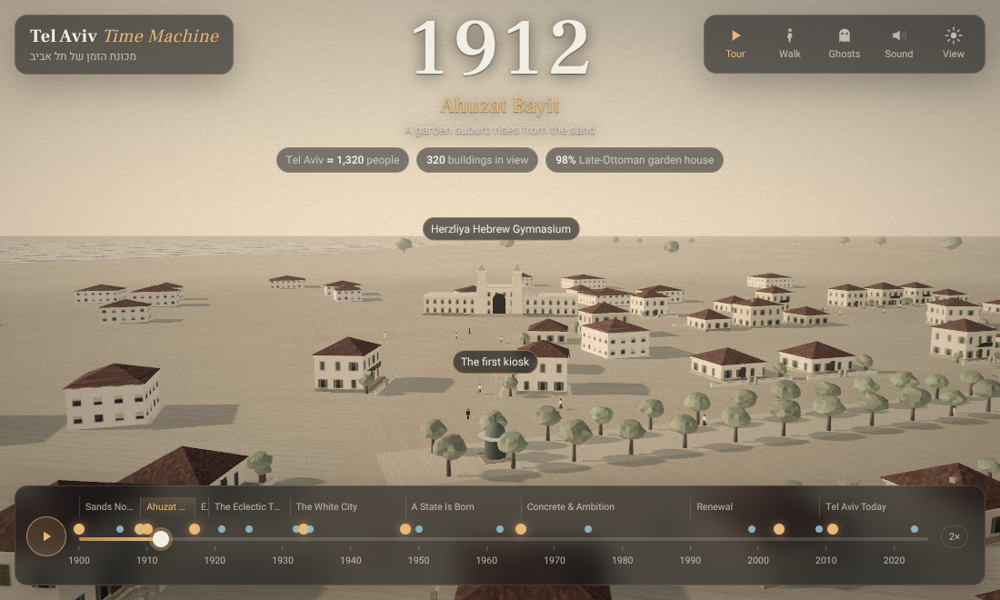
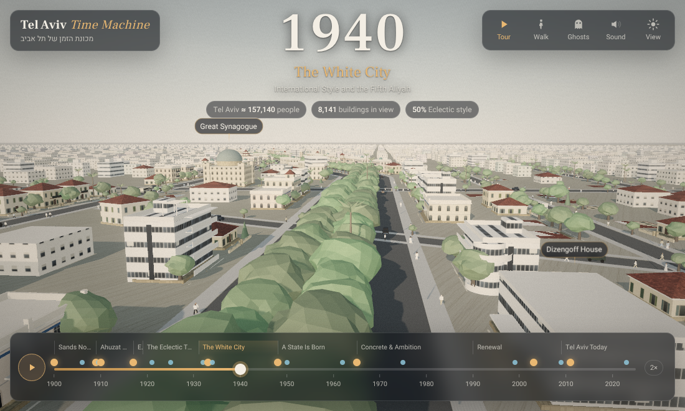
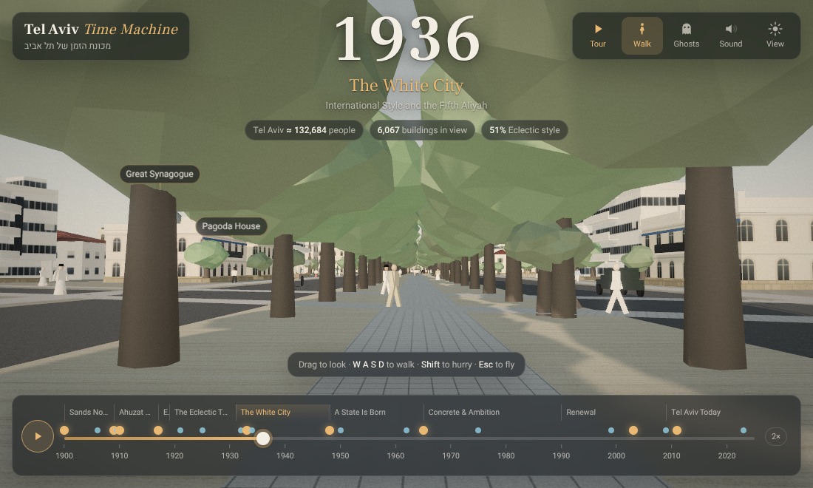
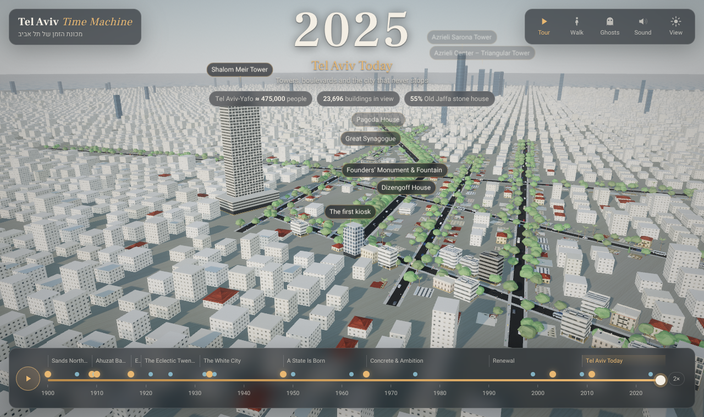

# Tel Aviv Time Machine · מכונת הזמן של תל אביב

A web-based 3D **time-travel exploration game** set in Tel Aviv. Walk the streets at eye level in
seven different years, from the sand dunes of 1909 to today, and keep a **field notebook** of what
you notice about how the city was built.

Nothing is marked. The notebook has three sections: **architecture**, **urbanism** and
**culture**. Each page says what to look for, never where: ribbon balconies and thermometer
windows, a house on columns, a grey building that turned white again, a school that became a
tower, the trees of Rothschild Boulevard. You notice things by looking closely, by comparing two
years in one place (slip or peek through a time lens), and by standing where two real archive
photographs were taken.

The original "scroll through time" experience is still there as **Free explore**: orbit above
the city, scrub the timeline from sand dunes (1900) to today's towers (2025), and click any
building to hear its life story. See [docs/GAME_DESIGN.md](docs/GAME_DESIGN.md) for the design.

<!--SHOTS-->

The interface design and the research behind it are in [docs/UI_DESIGN.md](docs/UI_DESIGN.md).

Free explore:

| 1912 — Ahuzat Bayit and the Gymnasium | 1940 — Rothschild Blvd, the White City |
| --- | --- |
|  |  |
| **1936 — walking the boulevard** | **2025 — today** |
|  |  |

## Quick start

```bash
npm install
npm run dev        # http://localhost:5173
npm test           # content & generator tests
npm run build      # static site in dist/
```

Deep links: `http://localhost:5173/#year=1948`.

## Controls

**Exploring (game)**

| | |
| --- | --- |
| Mouse: click once, then move it (`Esc` frees it) · touch: drag | Look around |
| `W A S D` (touch: the stick) | Walk (`Shift` to hurry) |
| Hold your look on something · click / tap · `E` | Notice it: a ring fills at the centre, then it goes into the notebook |
| Year tickets: tap a year (`1`–`7`) · hold a year (`Q`) | Slip to that year · peek into it from where you stand |
| The postcard · `P` | Hold up an old photo and line it up by eye; `H` while holding adds an aid |
| The tag · `J` | The notebook (with a *Nudge* for any entry you are stuck on) |
| The map disc · `M` · `Esc` | The map of the current year · menu |

**Free explore (classic timeline)**

| | |
| --- | --- |
| Drag / right-drag / scroll | Orbit / pan / zoom |
| Scroll over the timeline, `←` `→` (`Shift` = 10 years) | Travel in time |
| `Space` | Play / pause time |
| Click a building or label | Its life story, sources and style |
| `T` | Guided tour |
| `V` | Walk at street level (`W A S D`; click once and move the mouse to look, `Esc` frees the mouse, `Esc` again to fly) |
| `G` | Ghosts of demolished buildings |
| `M` | Ambient sound |

## What's inside

- A field notebook of 21 discoveries in four collections (*The White City*, *Before the White
  City*, *Building a city*, *City life*), plus style stamps and landmarks, all sourced.
- 1900–2025 with 9 eras, 21 sourced events and a 9-stop guided tour.
- 16 landmark sites (Herzliya Gymnasium, Shalom Meir Tower, Dizengoff House/Independence Hall,
  first kiosk, water tower, Founders' Monument, Great Synagogue, Pagoda House, Engel House, Jaffa
  Clock Tower, St Peter's, Jaffa station, Azrieli and Sarona towers).
- Procedural streets of ordinary buildings whose life stories follow real periods: Ottoman-era
  houses, eclectic, International Style, austerity blocks, concrete, contemporary, glass towers —
  with weathering, closed balconies, rooftop solar heaters, UNESCO-era restoration and TAMA 38
  floors.
- Pedestrians in period dress, camels, carts, buses and cars; trees that grow for decades;
  dunes that flatten as the city spreads; day/night; period film grading; procedural sound.

Everything is generated in the browser. The only binary assets are the two archive photographs
in the notebook (see Credits).

## Honesty

Landmarks and events carry a confidence badge and sources. Ordinary buildings are an
*illustrative reconstruction* of typical fabric, not specific addresses; street geometry is
hand-sketched and will be replaced with GIS data (see the roadmap).

## Credits

The notebook's photographs are public domain and come from Wikimedia Commons:

- [Herzl Street and the Herzliya Gymnasium, 1913](https://commons.wikimedia.org/wiki/File:THE_HERZL_%22GYMNASIA%22_(SECONDARY_SCHOOL)_AT_THE_ENDOF_HERZL_STRREET_IN_TEL_AVIV._%D7%A8%D7%97%D7%95%D7%91_%D7%94%D7%A8%D7%A6%D7%9C_%D7%91%D7%AA%D7%9C_%D7%90%D7%91%D7%99%D7%91..jpg)
  — photographer unknown, National Photo Collection of Israel.
- [The lottery of Ahuzat Bayit, 11 April 1909](https://commons.wikimedia.org/wiki/File:TelAviv-Founding.jpg)
  — Avraham Soskin.

## Docs

- [docs/GAME_DESIGN.md](docs/GAME_DESIGN.md) — the exploration game: theory, core loop, mechanics, the notebook's content
- [docs/RESEARCH.md](docs/RESEARCH.md) — experience design, story arc, data sources, fun & education
- [docs/ARCHITECTURE.md](docs/ARCHITECTURE.md) — technical decisions and module map
- [docs/ROADMAP.md](docs/ROADMAP.md) — milestones
- [docs/CONTENT_GUIDE.md](docs/CONTENT_GUIDE.md) — how to add buildings, events and streets
