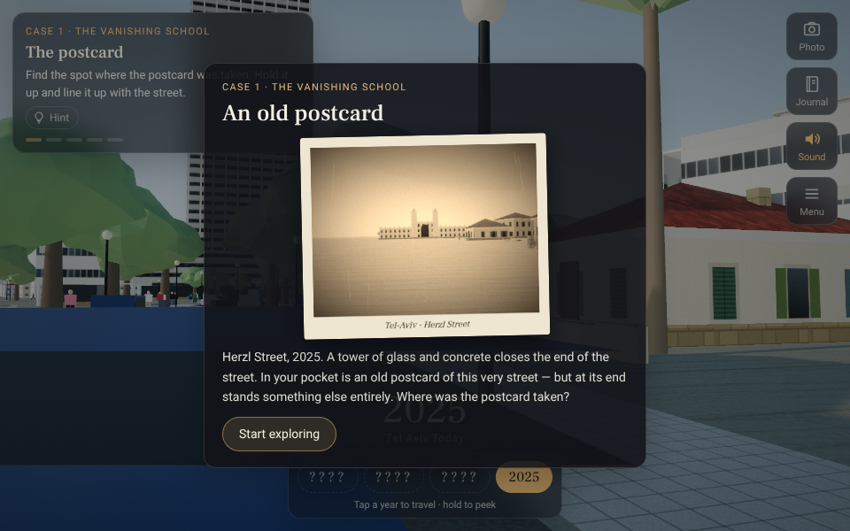
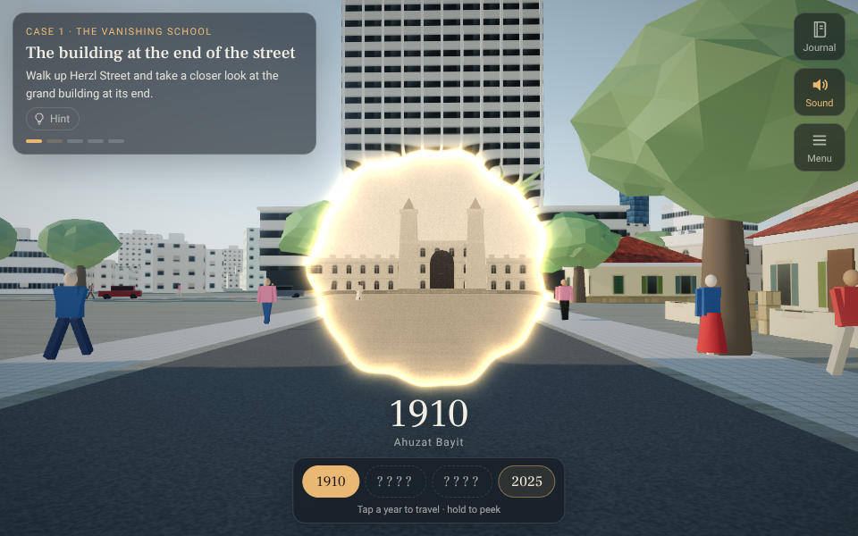
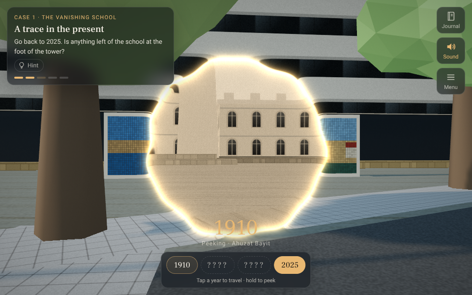
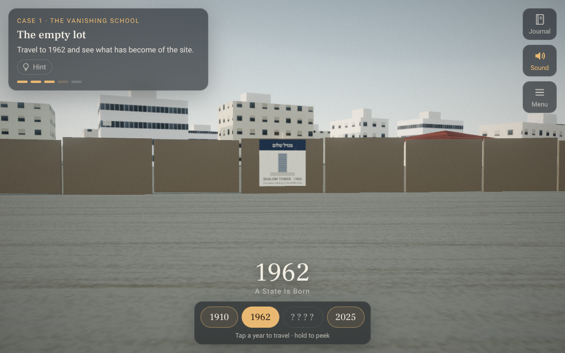

# Tel Aviv Time Machine · מכונת הזמן של תל אביב

A web-based 3D **time-travel exploration game** set in Tel Aviv. Walk the streets at eye level,
notice what is missing, stand where old photographs were taken and slip between 1900 and today to
solve the city's mysteries.

**Case 1 · The Vanishing School:** a postcard shows a grand building at the end of Herzl Street,
but in 2025 a tower stands there. Find where the postcard was taken, step into 1910, follow the
clues through 1962 and 1965, and work out what happened.

The original "scroll through time" experience is still there as **Free explore**: orbit above
the city, scrub the timeline from sand dunes (1900) to today's towers (2025), and click any
building to hear its life story. See [docs/GAME_DESIGN.md](docs/GAME_DESIGN.md) for the design.

| The postcard that starts Case 1 | Lining it up slips you into 1910 |
| --- | --- |
|  |  |
| **Peeking into 1910 from the foot of the tower** | **1962: what happened to the site?** |
|  |  |

Free explore:

| 1912 — Ahuzat Bayit and the Gymnasium | 1940 — Rothschild Blvd, the White City |
| --- | --- |
|  |  |
| **1936 — walking the boulevard** | **2025 — today** |
|  |  |

## Quick start

```bash
npm install
npm run dev        # http://localhost:5173
npm test           # content & generator tests
npm run build      # static site in dist/
```

Deep links: `http://localhost:5173/#year=1948`.

## Controls

**Case (game)**

| | |
| --- | --- |
| Drag · `W A S D` (touch: stick + drag) | Look · walk (`Shift` to hurry) |
| Click / tap · `E` | Examine what you are looking at |
| Time compass: tap a year · hold a year (`Q`) | Slip to that year · peek into it from where you stand |
| `P` | Hold up the old photo (rephotography) |
| `J` · `H` · `M` · `Esc` | Journal · hint · sound · menu |

**Free explore (classic timeline)**

| | |
| --- | --- |
| Drag / right-drag / scroll | Orbit / pan / zoom |
| Scroll over the timeline, `←` `→` (`Shift` = 10 years) | Travel in time |
| `Space` | Play / pause time |
| Click a building or label | Its life story, sources and style |
| `T` | Guided tour |
| `V` | Walk at street level (`W A S D`, drag to look, `Esc` to fly) |
| `G` | Ghosts of demolished buildings |
| `M` | Ambient sound |

## What's inside

- 1900–2025 with 9 eras, 21 sourced events and a 9-stop guided tour.
- 16 landmark sites (Herzliya Gymnasium, Shalom Meir Tower, Dizengoff House/Independence Hall,
  first kiosk, water tower, Founders' Monument, Great Synagogue, Pagoda House, Engel House, Jaffa
  Clock Tower, St Peter's, Jaffa station, Azrieli and Sarona towers).
- Procedural streets of ordinary buildings whose life stories follow real periods: Ottoman-era
  houses, eclectic, International Style, austerity blocks, concrete, contemporary, glass towers —
  with weathering, closed balconies, rooftop solar heaters, UNESCO-era restoration and TAMA 38
  floors.
- Pedestrians in period dress, camels, carts, buses and cars; trees that grow for decades;
  dunes that flatten as the city spreads; day/night; period film grading; procedural sound.

Everything is generated in the browser — no binary assets.

## Honesty

Landmarks and events carry a confidence badge and sources. Ordinary buildings are an
*illustrative reconstruction* of typical fabric, not specific addresses; street geometry is
hand-sketched and will be replaced with GIS data (see the roadmap).

## Docs

- [docs/GAME_DESIGN.md](docs/GAME_DESIGN.md) — the exploration game: theory, core loop, mechanics, cases
- [docs/RESEARCH.md](docs/RESEARCH.md) — experience design, story arc, data sources, fun & education
- [docs/ARCHITECTURE.md](docs/ARCHITECTURE.md) — technical decisions and module map
- [docs/ROADMAP.md](docs/ROADMAP.md) — milestones
- [docs/CONTENT_GUIDE.md](docs/CONTENT_GUIDE.md) — how to add buildings, events and streets
