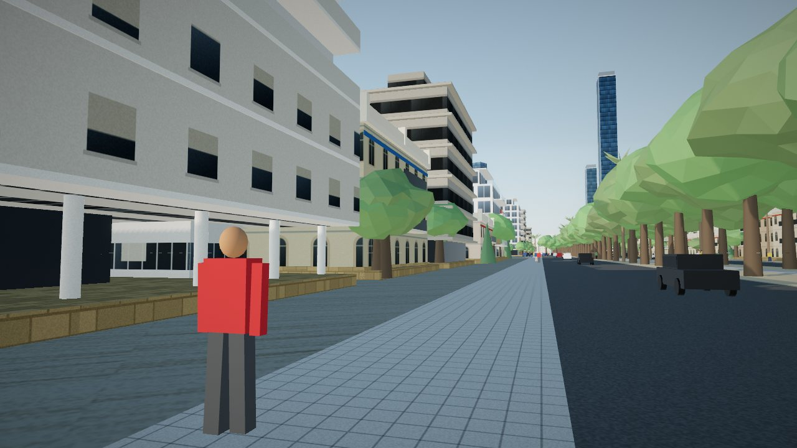
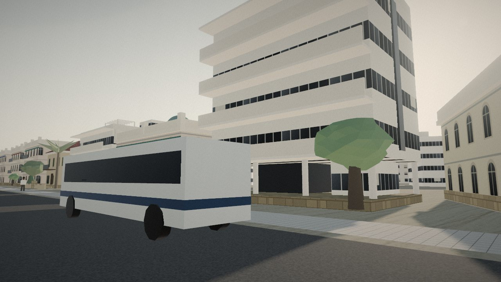
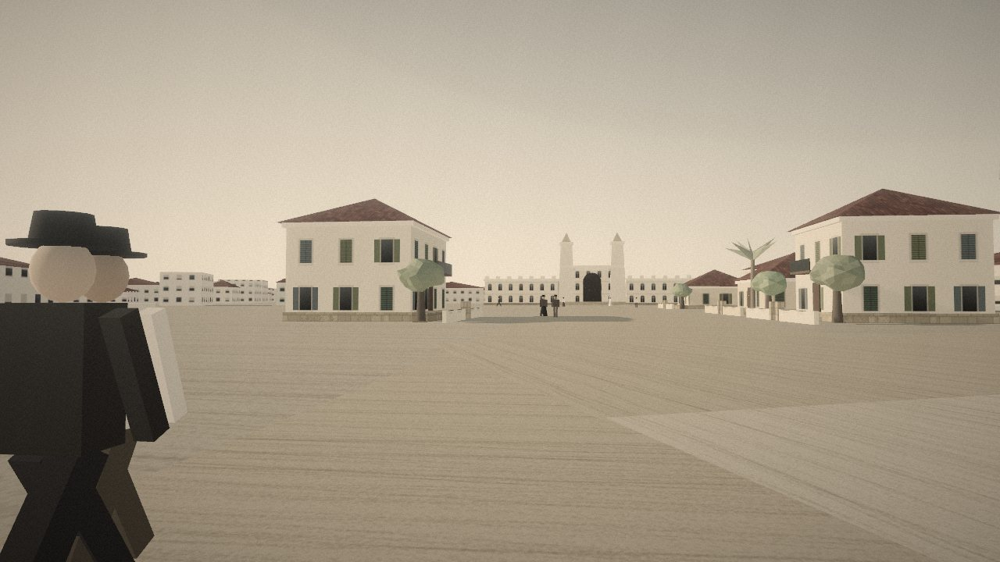
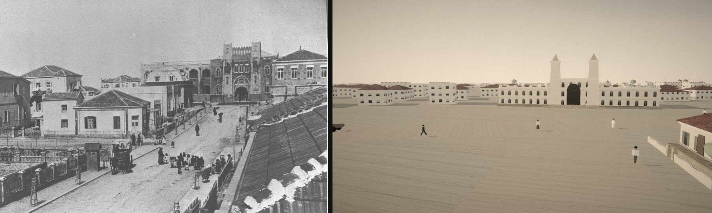

# Street-level realism: plan (Milestone 0.6)

Status: **approved (30 Oct 2026). Step 1 of the slice (performance foundation) is done**; see §7.

## 1. Where we are (measured 30 Oct 2026, RTX 3070, Chrome, 1280×720 unless noted)

| Scene | Draw calls (with / without shadow pass) | Triangles per frame | Visible building meshes |
| --- | --- | --- | --- |
| Rothschild Blvd 2025, sidewalk | 1,153 / 379 | 2.09 M (1.12 M without shadows) | 1,162 |
| Herzl St 1922, street level | 939 | 0.70 M | — |
| Herzl St 1922, photo pose (9 m) | 722 | 0.69 M | — |
| Bauhaus block, Herzl St 1936 | 2,399 | 1.32 M | — |

- A whole frame (shadow map, scene with 4× MSAA, 12 bloom quads, grade, lens) costs about
  **3 ms** at 1920×1080 measured with `gl.finish`. The desktop has five times the headroom it
  needs. (The WebGL timer-query numbers from ANGLE were unreliable, so they're not used here.)
- **The shadow map is two-thirds of all draw calls.** The 4k sun shadow redraws every building
  near the camera every frame.
- **One mesh per building**, each with 2–5 material groups. That is fine on desktop, but on a
  phone it's the main CPU cost: a mid-range phone manages roughly 200–300 draw calls at 30 fps.
- Post passes after the first one also render into 4× MSAA half-float targets, which wastes
  bandwidth on phones.
- Textures are 37 canvas textures at 40 px/m with no normal or roughness maps, and the lighting
  has no ambient occlusion.

Screenshots of today's look are in `docs/screenshots/realism/`:

| | |
| --- | --- |
|  Rothschild 2025 |  Bauhaus, Herzl St 1936 |
|  Herzl St 1922 |  1913 print vs. the model from the photo pose (walking lens) |

**What reads as fake, in order of impact:**

1. **Trees.** The low-poly blobs fill half the frame on Rothschild.
2. **Flat walls.** Windows are painted on, with no reveals, sills, shutters, cornices or quoins.
3. **Streets have no edge.** There are no curbs, gutters, drains, stains or wear.
4. **No contact darkness.** Without ambient occlusion, buildings float on the ground.
5. **Herzl 1922 is a sand plaza.** The print shows a laid-out street with curbs, picket and iron
   fences, saplings in wooden ladder guards, a kiosk, and houses close to the street on both
   sides. Part of this gap is content (the street surface and props). Part of it is layout:
   there are missing parcels near Rothschild. See question 4.
6. **The people are box figures.** This is outside 0.6, but it is the next thing the eye
   catches once the walls are fixed.

## 2. Pipeline

```
reference board (archive prints + present-day photos)
      │
Blender 4.5 LTS ── kit modules per style, built from Python scripts in tools/blender/
      │            (text in git; .blend only where hand modelling is needed)
      │            baked AO in vertex colour / 2nd UV
      ▼
.glb (raw) ── gltf-transform: meshopt + quantize; KTX2 (ETC1S for colour, UASTC for normals)
      │       two texture sizes: 1K (phone) and 2K (laptop / desktop)
      ▼
public/kits/<style>.glb  +  public/materials/<name>_{1k,2k}.ktx2
      │
runtime: GLTFLoader + MeshoptDecoder + KTX2Loader (all already in three/examples, so no new
         runtime dependency; the basis transcoder wasm is copied into public/)
```

- **Façade grammar (new, pure and tested).** `(site, phase, rng) → module placements`: bays,
  doors, corners, cornice runs, balconies, roof pieces and clutter. It fills the *existing*
  footprint and floor heights, so site ids, positions, footprints, `roofHeight` and
  `blockedAt` don't change. Vitest checks that every placement stays inside its footprint and
  that the top of the roof matches `roofHeight`.
- **Rendering kits.** Kit modules are drawn as instanced or `BatchedMesh` per module and material,
  with one texture array per style. Draw calls scale with the number of distinct modules, not
  with the number of buildings.
- **LOD.**
  - LOD0: the kit within about 80 m of the player (60 m on phones).
  - LOD1: today's procedural mesh with the new materials.
  - LOD2: the city blanket.
  - The procedural mesh stays the picking, collision and ghost proxy, so `userData` (`siteId`,
    `phaseIndex`, `ghost`) is unchanged.
- **Materials.** Photo-sourced CC0 PBR sets from **ambientCG** and **Poly Haven**:
  - lime plaster in three roughnesses, kurkar and limestone ashlar, terrazzo, Marseille clay roof
    tiles (imported to early Tel Aviv), asphalt, concrete pavers, cobbles, packed sand road;
  - a source and licence line for each set goes in the README credits.
- **Ageing per year.** The shader mixes in grime, from triplanar noise plus streaks under sills,
  and flaking paint by `phase.weathering`, and pulls colour from `phase.color`. A restored
  building in 2011 or 2025 gets fresh paint; the same building in 1985 is grey. Same geometry,
  different year.
- **Clutter per era.**
  - 1922: picket and iron fences, garden walls, ladder tree guards, kerosene lamp posts,
    carts, a kiosk.
  - 2025: Rothschild kiosks, benches, bike docks, signs, posters, wires, AC units, solar
    heaters, scooters, cracked curbs.
  - Each prop is one instanced kit.
- **Trees.** Ficus, royal poinciana and Washingtonia palm are generated in Blender (Sapling)
  with leaf cards and baked AO. A far impostor takes over past about 60 m.
- **References.**
  - Archive prints from Wikimedia Commons (public domain). National Library and Pikiwiki
    photos are used for reference only, never shipped.
  - Present-day reference from the owner's own photos of the slice block, or Mapillary
    (reference only).

## 3. Lighting, anti-aliasing and resolution

- **Shadows.** A tight sun shadow, about 60 m around the player, cached: the map is redrawn
  only when the player moves more than 2 m or the hour changes, not every frame. Baked AO in
  the kits and a soft contact-AO decal under each building.
  - Desktop: GTAO on top.
  - Phones: no real-time AO.
  - This alone should cut draw calls by about 60 %.
- **TAA with dynamic resolution, replacing 4× MSAA.**
  - Render the scene at scale *s* with Halton jitter, reproject the history using depth and
    the previous view-projection, clamp in YCoCg against the neighbourhood, then upscale with
    an FSR1-style sharpen.
  - Resolution controller: the target frame time comes from `requestAnimationFrame` deltas,
    with hysteresis. *s* ranges from 0.5 to 1.0 on phones, 0.67 to 1.0 on laptops and 0.85 to
    1.0 on desktops.
  - Moving people and cars would ghost without velocity vectors. Neighbourhood clamping handles
    most of it; if not, we add a velocity pass for the instanced movers.
- **Post chain.** It moves to non-MSAA targets at the TAA resolution. Bloom runs at quarter
  resolution. The per-era film grade, grain and vignette stay as they are, applied last, so the
  archival mood holds.

## 4. Quality tiers

| | Phone | Laptop (integrated GPU) | Desktop |
| --- | --- | --- | --- |
| Target | **30 fps** stable, 60 on recent iPhones | 60 fps at 1080p | **60 fps** at 1440p (≤ 8 ms) |
| Draw calls (all passes) | ≤ 250 | ≤ 500 | ≤ 1,000 |
| Triangles per frame | ≤ 0.6 M | ≤ 1.5 M | ≤ 4 M |
| Textures | 1K KTX2, ≤ 150 MB GPU | 2K, ≤ 300 MB | 2K, ≤ 500 MB |
| Kit LOD0 radius | 60 m | 80 m | 120 m |
| Shadows | 1K cached, 40 m | 2K cached, 60 m | 2K cached + GTAO |
| Anti-aliasing | TAA, scale 0.5–1.0 | TAA, scale 0.67–1.0 | TAA, scale 0.85–1.0 |

- **Picking the tier.** An initial guess comes from `WEBGL_debug_renderer_info`,
  `deviceMemory` and the screen size. A 2-second check while the first year builds then
  confirms it.
- **Override.** The menu has a manual override, stored under a new key, `tlvtm.quality`. The
  notebook save format is not touched.
- **Download.**
  - First load on a phone: ≤ 8 MB including the archive photos.
  - Each additional style: ≤ 3 MB at 1K, fetched lazily when the player gets close.
  - In the repo: about 10 MB for the slice and an estimated 40–60 MB for all styles, served
    straight from Pages without LFS.

## 5. Vertical slice

**Area:**

- Herzl Street from Rothschild to the head of the street (the Gymnasium in 1922, Shalom Meir
  Tower in 2025);
- one block of Rothschild Boulevard either side of Herzl;
- both in 1922 and 2025.

**Order of work**, each step measured on this PC and on a phone:

1. **Performance foundation, before any art:**
   - cached shadow;
   - non-MSAA post chain;
   - TAA with dynamic resolution;
   - quality tiers;
   - an on-screen stats overlay (`#stats`).
   - Expected result: the same image as today with about a third of the draw calls.
2. **Pipeline:**
   - the Blender script harness;
   - gltf-transform build script (`npm run kits`);
   - KTX2 and meshopt loaders;
   - the first CC0 material sets with per-year ageing.
3. **Kits for the slice:**
   - Ottoman and eclectic houses for 1922;
   - eclectic (restored), Bauhaus and modern for 2025;
   - a bespoke Gymnasium model that keeps the 17.6 m tower tops and the arch the photo marks
     use;
   - the Shalom Meir Tower.
4. **Streets and clutter:**
   - curbs with real profiles, gutters and stain decals;
   - the 1922 fences and tree guards;
   - the 2025 kiosk and benches;
   - the new trees.
5. **Check:**
   - side-by-side comparison with the 1913 print and with present-day photos;
   - the Herzl photo still lines up in photo mode;
   - `npm test` and `npm run build` green;
   - fps on this PC and on a phone via `npm run dev -- --host`.

## 6. Decisions (owner, 30 Oct 2026)

1. **Tools: yes.**
   - Blender LTS (4.5, the current LTS) and KTX-Software on the workstation.
   - `@gltf-transform/cli` as a dev-dependency.
   - No new runtime dependency.
2. **Binary assets: left to us, as long as the repo can be slimmed later.** Policy:
   - **No generated binaries in git history.** Kits (`.glb`) and textures (`.ktx2`) are build
     outputs.
   - What git holds is text: the Blender Python scripts, the material list (ambientCG / Poly
     Haven ids with licence and source), and a small `assets.lock.json` (version and SHA-256
     per file).
   - The built asset pack is published as a **GitHub Release asset** of this repo, which does not
     count towards the repo's size.
   - CI downloads the pinned version and checks the hashes before `vite build`. Locally,
     `npm run assets` builds the pack (or fetches it), into an ignored folder.
   - Moving the pack elsewhere later (another repo, a CDN, LFS) only changes the URL in the lock
     file, and nothing ever has to be purged from history.
   - The few hand-modelled `.blend` sources that can't be scripted live outside the repo, in the
     same release.
3. **Phone: Samsung Galaxy S21.** It runs the `phone` tier, with a 30 fps target and up to
   60 fps when it can.
4. **Herzl 1922 layout: our call.** The slice may add or adjust fabric parcels near Rothschild
   where the sources back it. The rephoto marks, `roofHeight` and the noticing tests must keep
   passing.
5. **Present-day reference: Mapillary and Wikimedia Commons**, for reference only; nothing
   from them is shipped.

## 7. Progress

### Step 1: performance foundation (done)

- **Cached sun shadow** on the phone and laptop tiers. It is redrawn only when:
  - the shadow frustum moves (the player has walked about 8 % of its width);
  - the sun turns;
  - the year changes;
  - a building rises, sinks or is built.

  Walkers and cars cast no shadow on those tiers; the desktop keeps every-frame shadows.
- **TAA with upsampling** (`TAAPass`) replaces 4× MSAA:
  - the scene at a dynamic render scale with 16-sample Halton jitter;
  - reprojection through the logarithmic depth buffer, respecting the photo frame's view
    offset;
  - YCoCg neighbourhood clipping;
  - Catmull-Rom upsampling and a contrast-adaptive sharpen.

  The history is cleared on cuts, resizes and instant year jumps. The photo plates render in
  one unjittered frame, so the tracing aid is as crisp as before.
- **Post chain** runs on non-MSAA buffers.
- **Quality tiers.** They're detected from the GPU and screen; `#quality=` forces one, and
  Menu → *Picture: light / balanced / full* switches live and is remembered on the device
  (`tlvtm.quality`, separate from the notebook save).
- **Dynamic resolution** (`ResolutionController`, tested). It lowers the scale when frames run
  late and probes back up, backing off after a failed probe.
- **`#perf` overlay** (or Shift+P), also readable as `tlvtm.perf.last`.

Measured on the RTX 3070 at Rothschild 2025, sidewalk, 1280×720, all passes counted:

| Tier | Draw calls | Triangles | Render scale | fps |
| --- | --- | --- | --- | --- |
| before (MSAA, every-frame shadow) | 1,153 | 2.09 M | 1.00 | 60 (vsync) |
| desktop | 1,156 | 2.09 M | 1.00 | 60 |
| laptop | 381 | 1.12 M | 0.93 | 60 |
| phone | 381 | 1.12 M | 0.78 | 60 |
| phone, 390×844 portrait at the start spot | 216 | 1.11 M | 0.86 | 60 |

The phone tier is now under its 250-draw budget in portrait at the start spot. Rothschild in
landscape (381) still needs the kit batching from step 3. **Galaxy S21: not measured yet.**

### Next

Step 2: the asset pipeline, following the storage policy above.
